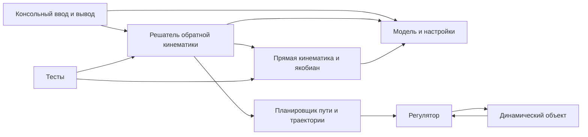

# Архитектура учебной системы моделирования и управления манипулятором

Статус: проект будущей реализации. Обязательный объём задан [требованиями](requirements.md), последовательность работ — [планом](evolution.md). Обозначения согласованы с [пособием ИТМО и замечаниями к нему](theory.md). Система поддерживает кинематику, динамику, планирование, управление и численную симуляцию последовательной цепи из 3–6 вращательных суставов.

## Компоненты и зависимости



Для локальной консольной версии один процесс и один поток достаточны. Чистая математическая библиотека и консольный executable — две границы сборки. Модель данных, прямая кинематика и решатель могут быть отдельными исходными файлами одной библиотеки. Дополнительные сервисы, транспортные порты и контейнеры для задачи не нужны.

| Компонент | Ответственность | Чего не должен знать |
| --- | --- | --- |
| RobotModel | Проверенная таблица стандартных DH-параметров, база и инструмент | Консоль, способ решения |
| ForwardKinematics | Преобразования звеньев, позиция конца, оси/начала суставов в базе | Ввод пользователя и критерии остановки поиска |
| PositionIkSolver | Поиск углов по модели, цели и настройкам | Формат печати, ROS и оборудование |
| SolveOptions / SolveResult | Допуск, пределы поиска, статус, углы, ошибка, итерации | Хранение и сетевые DTO |
| ConsoleApp | Выбор примера, чтение координат, вызов и печать результата | Детали линейной алгебры |

## Модель и единицы

Внутренние единицы: метры и радианы; углы можно дополнительно печатать в градусах. JointAngles связан с моделью проверкой размера. RobotModel содержит 3–6 строк стандартных параметров Денавита–Хартенберга: a_i, alpha_i, d_i, theta_offset_i. Вращательная координата theta_i = q_i + theta_offset_i. Ось i-го сустава — z_(i-1); положительное вращение определяется правилом правой руки. Модифицированная DH-конвенция не используется.

Согласно печатным с. 12 и 15 пособия, локальное преобразование из кадра i в i-1:

```text
A_i(q_i) = Rz(theta_i) Tz(d_i) Tx(a_i) Rx(alpha_i)

      [ cθ  -sθ cα   sθ sα   a cθ ]
A_i = [ sθ   cθ cα  -cθ sα   a sθ ]
      [  0      sα      cα       d ]
      [  0       0       0       1 ]
```

Здесь c и s обозначают cos и sin соответствующего угла. Используются векторы-столбцы; порядок умножения фиксирован. База T_world_base и инструмент T_n_tool — фиксированные преобразования SE(3), по умолчанию единичные. DH-смещения a_i и d_i могут быть нулевыми и знаковыми: они не равны автоматически физической длине звена. Запрет всех нулевых DH-параметров ошибочно исключил бы допустимые модели.

Проверяются конечность параметров, число суставов, размер q, положительные допуски/бюджеты, корректность SE(3) базы/инструмента. Требования к положительным физическим размерам относятся к выбранному демонстрационному профилю, а не ко всем a_i/d_i. [Модель и контрольные позы](model.md) определяют геометрию до реализации. Поступательные пары рассмотрены в теории, но текущий контракт JointAngles поддерживает только вращательные; неизвестный тип не преобразуется молча во вращательный.

## Прямая и обратная кинематика

Прямая кинематика возвращает полное преобразование рабочего органа и промежуточные кадры:

```text
T_world_tool(q) = T_world_base A_1(q_1) ... A_n(q_n) T_n_tool
T_world_tool = [ R  p ]
               [ 0  1 ]
```

Цель target и p выражены в одной мировой системе. Для текущего задания используется только p — первые три элемента последнего столбца. Матрица R нужна для преобразований, но её ошибка не входит в целевую функцию. Вычисление углов Эйлера и задание единичной целевой ориентации не требуются.

Для каждого сустава из T_world_base A_1 ... A_(i-1), до применения A_i, берутся ось z_(i-1) и начало o_(i-1) в мировой системе. Позиционный якобиан J_v имеет размер 3×n:

```text
J_v[:, i] = z_(i-1) × (p_tool - o_(i-1))
```

Положение p_tool включает смещение инструмента. Один набор промежуточных преобразований используется для FK и якобиана. Это геометрический якобиан позиции, а не якобиан производных углов Эйлера. В пособии на с. 20 перепутаны подписи типов суставов; применяем приведённую выше формулу вращательного сустава и проверяем её центральными разностями (см. theory.md).

Для ошибки e = target - p(q) выбран метод damped least squares (DLS). Эта регуляризация дополняет изложенную в пособии теорию:

```text
(J_v J_vᵀ + λ² I_3) y = e
Δq = J_vᵀ y
```

Решается линейная система размером 3×3; явная обратная матрица не вычисляется. λ положителен. Решатель ограничивает норму шага и использует уменьшение шага при росте ошибки. Точные значения damping, шага и критериев стагнации фиксируются вместе с реализацией и тестами. Для матричных операций кандидат — Eigen; версия проверяется на совместимость с C++17 и закрепляется при каркасе. Публичные типы приложения не должны зависеть от форматирования Eigen.

Алгоритм:

1. Проверить модель, цель, начальную позу и настройки.
2. Проверить достаточные условия недостижимости, если они доступны для модели.
3. Вычислить прямую кинематику и ошибку позиции; при достижении допуска вернуть успех.
4. Вычислить якобиан, ограниченный шаг и новую позу; проверить конечность результата.
5. При стагнации перейти к следующему детерминированному начальному приближению.
6. При исчерпании бюджета вернуть no_convergence и лучшую найденную позу с её ошибкой.

Выпрямленная цепь может давать нулевой полезный шаг к некоторым целям. Поэтому одного нулевого начального приближения недостаточно: предусмотрены фиксированные ненулевые стартовые позы. Перезапуски повышают практическую сходимость, но не доказывают полноту метода.

Решатель минимизирует только ошибку позиции. Нельзя добавлять требование к ориентации конца: это изменит условие задачи и может сделать допустимую цель недостижимой. Если впоследствии потребуются ограничения суставов или ориентация, они оформляются отдельным расширением контракта и тестов.

## Результат и обработка отказов

SolveResult содержит status, angles, actual_position, position_error, iterations и attempts. Статусы: success, invalid_input, unreachable, no_convergence, numerical_failure. Для invalid_input углы и фактическая позиция могут отсутствовать; для неуспешного поиска лучшая поза явно помечается приближением. Итерации суммируются по попыткам, поэтому общий предел проверяем.

Успех подтверждается повторной прямой кинематикой возвращённых углов. ConsoleApp печатает код результата и возвращает ненулевой exit code при отказе. Некорректные данные не заменяются молча нулями.

## Динамика, планирование и управление

Расширенная работа добавляет три независимых математических слоя поверх общей модели:

| Компонент | Вход | Выход | Ответственность |
| --- | --- | --- | --- |
| `DynamicsModel` | `q`, `q_dot`, `q_ddot` и параметры звеньев | `M`, `C`, `G`, `F`, требуемый `tau` | Уравнения движения и обратная динамика |
| `PathPlanner` | Начальная/конечная конфигурации, ограничения | Геометрический путь `q(s)` | Допустимый маршрут в пространстве конфигураций |
| `TrajectoryGenerator` | Путь, время, ограничения скорости/ускорения | `q_d(t)`, `q_dot_d(t)`, `q_ddot_d(t)` | Временная параметризация пути |
| `JointController` | Желаемые и измеренные `q`, `q_dot` | Командный момент `tau` | Слежение с насыщением и диагностикой |
| `PlantSimulator` | `tau`, состояние и параметры | Следующее `q`, `q_dot` | Численное интегрирование замкнутого объекта |

Базовая динамическая модель:

```text
M(q) q_ddot + C(q, q_dot) q_dot + G(q) + F(q_dot) = tau
```

Для обратной динамики сначала реализуется рекурсивный Ньютон–Эйлер либо эквивалентная проверенная формулировка. `M`, `C`, `G` и трение доступны по отдельности для анализа. Простейший регулятор — PD с компенсацией гравитации:

```text
e = q_d - q
e_dot = q_dot_d - q_dot
tau = Kp e + Kd e_dot + G(q)
```

Computed-torque добавляется после проверки модели:

```text
tau = M(q) (q_ddot_d + Kd e_dot + Kp e) + C(q,q_dot)q_dot + G(q) + F(q_dot)
```

Перед подачей в объект применяются лимиты момента; интегральная часть, если появится, имеет anti-windup. Управление по усилию/импедансное управление остаётся отдельным контроллером.

Планировщик пути отвечает за маршрут в пространстве конфигураций, генератор траектории — за время и производные. Для демонстрации обязательна непрямая траектория или несколько промежуточных точек с изменением знака производной, как требует приложение А пособия. Минимальный вариант — кубические полиномы между waypoint-ами с нулевыми скоростями на концах; при нарушении ограничений время сегмента увеличивается.

Замкнутый цикл симуляции:

```text
q_d(t), q_dot_d(t), q_ddot_d(t)
                 |
                 v
          JointController -- tau --> PlantSimulator
                 ^                       |
                 |-------- q,q_dot ------|
```

`PlantSimulator` интегрирует ускорение из динамического уравнения фиксированным методом и шагом. Регулятор использует только текущее измеренное состояние; планировщик и регулятор не вызывают друг друга скрыто. Каждый эксперимент сохраняет параметры, начальное состояние, шаг интегрирования и версию solver.

## SOLID в масштабе задачи

| Принцип | Применение | Проверка |
| --- | --- | --- |
| S — одна ответственность | Модель, FK, IK и консоль разделены | Изменение формата вывода не меняет математический код |
| O — открытость расширению | Геометрия и количество звеньев передаются данными; решатель не содержит ветвления по модели робота | Новая конфигурация 3–6 звеньев проходит тот же алгоритм |
| L — подстановка | Пока нет иерархий наследования, искусственная иерархия не создаётся; будущие решатели обязаны сохранять семантику результата и допуска | Общие тесты проверяют позицию, а не конкретные углы |
| I — разделение интерфейсов | Малые операции forward и solve; нет универсального интерфейса «робот умеет всё» | Тест FK не создаёт консоль или решатель |
| D — инверсия зависимостей | ConsoleApp зависит от контракта математической библиотеки; библиотека не зависит от ввода-вывода | Сборка/тест библиотеки без executable |

Передача RobotModel и SolveOptions через аргументы достаточна. Интерфейс стратегии нужен только при появлении второго алгоритма или внешнего решателя. SOLID не требует виртуального класса на каждую структуру, DI-framework или микросервисов.

## Масштабирование

Обязательное масштабирование — от 3 до 6 суставов и смена геометрии. Позиционная задача локально имеет не более трёх независимых ограничений; при rank(J_v) = 3 и n > 3 возникает локальная избыточность. Наличие шести суставов не делает позиционный якобиан квадратным. Разделение на положение первых трёх и ориентацию последних трёх суставов допустимо лишь для подходящей геометрии и не является общим решателем.

Один проход FK и построение якобиана имеют линейную зависимость от числа суставов; система DLS остаётся 3×3 для позиционной цели. Объём поиска ограничен настройками.

При появлении GUI он вызывает ту же библиотеку. Пакетный расчёт независимых целей можно распараллелить с отдельным состоянием решателя; это не входит в первую версию. Для управления реальным роботом понадобятся планирование траектории, ограничения, исполнение и аппаратная безопасность: они не следуют автоматически из решения IK.

## Портируемые модули и профиль микроконтроллера

[План модулей и последовательного протокола](embedded.md) предусматривает `kinematics-module` и `modbus-rtu-module` как независимые submodule. Они имеют собственные публичные API, конфигурацию и host-тесты; приложение лишь соединяет их. Уже при каркасе размеры ограничиваются шестью суставами, workspace передаётся явно, вычисления не используют консоль/HAL и не выделяют память в solve. Конкретный MCU toolchain и численная точность проверяются после выбора платы.

При удалённом расчёте CLI вызывает клиент протокола вместо локального solve. Небольшой контракт задания/результата позволяет заменить локальный вызов удалённым; транспортные ошибки отделены от математического SolveResult. Нельзя выдавать timeout связи за no_convergence. Диспетчер прошивки обслуживает протокол и вызывает ограниченные шаги вычисления вне ISR. Это конкретное применение SRP/DIP: математика, обмен и драйвер UART имеют разные причины изменения. Modbus-кодек не знает карту регистров, а карта регистров не знает деталей UART.

Рабочий кандидат связи — Modbus RTU по RS-232, с согласованием электрических уровней UART. ROS 2 и RTOS не являются обязательными. Сборка для МК, регистры и управление приводами добавляются только на соответствующих этапах; локальная CLI остаётся независимым способом проверки.

## Предлагаемая структура

```text
CMakeLists.txt
include/manipulator/       robot_model.hpp, kinematics.hpp, ik_solver.hpp
                           dynamics.hpp, planner.hpp, trajectory.hpp, controller.hpp
src/                       robot_model.cpp, kinematics.cpp, ik_solver.cpp
                           dynamics.cpp, planner.cpp, trajectory.cpp, controller.cpp
app/                       main.cpp, демонстрационная конфигурация
tests/                     проверки FK, IK и ввода
docs/                      требования, модель, алгоритм, инструкция
```

При реализации создаются targets manipulator_kinematics и manipulator_cli, тесты регистрируются в CTest. Геометрия и ручные контрольные примеры заданы в [model.md](model.md).

## Основания алгоритма

Основной учебный источник — [пособие ИТМО](Modelirovanie_i_upravlenie_dvizheniem_robotov_-_ITMO.pdf), §1.1.1–1.1.3; карта страниц и замечания — [theory.md](theory.md). Итеративная IK, зависимость от начального приближения и использование якобиана разобраны в [Modern Robotics, раздел 6.2](https://modernrobotics.northwestern.edu/nu-gm-book-resource/6-2-numerical-inverse-kinematics-part-1-of-2/). Варианты решения линейных систем — в [документации Eigen](https://libeigen.gitlab.io/eigen/docs-nightly/group__TutorialLinearAlgebra.html). Выбор DLS, позиционной цели и бюджетов является решением этого проекта; совместимая версия Eigen закрепляется при реализации.
