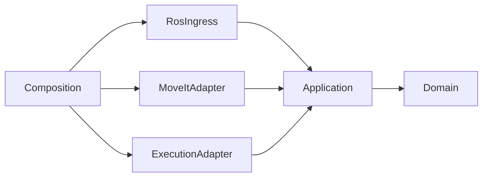

# Архитектурный контракт

Статус: требования к будущей реализации. Документ уточняет [план развития](evolution.md); при расхождении технических деталей приоритет имеют этот документ и [контракт API](api.md). Правила реализации: [C++17](cpp17.md).

## Цель переносимости

При переходе от mock-оборудования к реальному роботу сохраняются прикладные сценарии и публичный API. Меняются аппаратный адаптер, описание и калибровка робота, ограничения, настройки контроллеров и развертывание. Нельзя обещать перенос заменой одного класса: возможности контроллера, время реакции и процедуры запуска проверяются отдельно.

Первый профиль содержит шесть вращательных суставов. Имена, порядок и пределы приходят из проверенного профиля робота, а не из констант UR5e в прикладном коде. Поддержка произвольной кинематики пока не является требованием.

## Слои и зависимости исходного кода

| Слой | Содержимое | Разрешенные зависимости |
| --- | --- | --- |
| Domain | Цели, состояния, план, идентификаторы, инварианты | Стандартная библиотека C++17 |
| Application | Сценарии, автомат заданий, право управления, порты интеграции | Domain |
| Adapters | Преобразование DTO, MoveIt, ROS actions, состояние, часы | Application, Domain, необходимые внешние библиотеки |
| Composition | Создание объектов, ROS executor, конфигурация запуска | Конкретные адаптеры и Application |
| Hardware | Плагин ros2_control, протокол, отображение осей на приводы | ros2_control и SDK оборудования; без зависимости от Application |
| Web | Представление, ввод, клиент API | Публичные схемы API |

Стрелка зависимости исходного кода направлена от адаптера к порту Application. Application не включает заголовки ROS, MoveIt, JSON, HTTP, SDK приводов или Three.js. Domain и Application собираются обычным CMake и тестируются без ROS daemon, модели и оборудования. Ament используется для упаковки ROS-части, а не как обязательная зависимость ядра.



Это схема зависимостей библиотек, а не передачи команд. Во время выполнения Application вызывает внедренные порты, реализованные адаптерами.

## Порты Application

| Порт | Обязательный контракт |
| --- | --- |
| Planner | Асинхронный расчет по снимку состояния и сцены; результат или типизированная ошибка; ограничение времени |
| TrajectoryExecutor | Отправка одной траектории, подтверждение принятия, обратная связь, запрос отмены и сверка статуса по идентификатору |
| RobotStateSource | Согласованный снимок с последовательностью, временем получения, epoch источника, готовностью и качеством данных |
| SceneSource | Неизменяемый снимок либо версия сцены и модель, использованные при планировании |
| MonotonicClock | Измерение дедлайнов и срока действия управляющего сеанса; заменяемые часы в тестах |

Сигнатуры определяются при реализации первого сценария. Каждый асинхронный порт обязан определить владение запросом, контекст доставки результата, тайм-аут, отмену и завершение при shutdown. Принятие запроса портом не считается результатом движения. Инфраструктурные ошибки преобразуются в прикладные; тексты ошибок сторонних библиотек не становятся кодами API.

Порты вводятся для реальных границ интеграции. Для простых преобразований достаточно функций; интерфейс для каждого класса, service locator и глобальный контейнер зависимостей не нужны.

## Процессы и единственный владелец движения

Начальное развертывание: веб-шлюз, сервис управления заданиями, MoveIt move_group, controller_manager с контроллерами и robot_state_publisher. Библиотеки Domain и Application размещаются внутри сервиса заданий. Границы библиотек не требуют дополнительных процессов.

В production-конфигурации демонстратора единственный путь движения:

`Web -> Gateway -> Application -> ExecutionAdapter -> FollowJointTrajectory -> controller`.

MoveIt используется адаптером Planner для расчета. Выполнение через MoveIt/RViz отключается для операторского режима, чтобы не возник второй отправитель команд. RViz с возможностью движения допустим только в отдельном режиме разработчика, исключающем управление из веба. Ограничение доступа к ROS-сети требуется при развертывании за пределами доверенного локального окружения.

## Конкурентность и время

- Автоматом заданий и правом управления владеет один последовательный обработчик событий. Все callbacks публикуют ему события с идентификатором операции и generation; поздние результаты завершенных операций игнорируются.
- Планирование и сетевой ввод-вывод выполняются вне обработчика. ROS callback не ждет future, для завершения которого нужен тот же executor. Потоки принадлежат объектам и завершаются до уничтожения зависимостей.
- Очереди ограничены. Телеметрия может объединяться до последнего снимка; переполнение очереди команд возвращает отказ. События результата не теряются молча: при потере потока клиент восстанавливает снимок.
- Срок управляющего сеанса, свежесть данных и дедлайны измеряются монотонными часами. ROS time используется для согласования симуляции и преобразований; UTC используется для журнала. Эти шкалы не вычитаются друг из друга.
- Смена epoch источника либо скачок времени симуляции инвалидирует планы. Последовательность сообщений проверяется отдельно от временной метки.

Application работает вне контура реального времени. Контур controller_manager/оборудования не обращается к HTTP, планировщику или файловому журналу. Для аппаратного цикла заранее задаются частота, бюджет read/update/write, допустимые задержки и политика пропуска тактов. В нем исключаются неограниченные ожидания, выделение памяти после настройки и блокирующее логирование. Наличие ROS 2 само по себе не является гарантией real-time.

## Инварианты допуска движения

Перед отправкой траектории Application атомарно резервирует слот исполнения и проверяет управляющий сеанс, готовность, свежий снимок, модель, калибровку, ограничения, сцену и соответствие начальной позы плану в заданном допуске. Параллельное выполнение и смена конфигурации отклоняются.

План хранится на сервере, неизменяем и имеет срок действия. Браузер возвращает только plan_id. Декартова цель преобразуется в плановую систему координат по конкретному снимку TF; отсутствие преобразования дает ошибку. Quaternion проверяется на конечность и норму; допустимое нормирование задается контрактом. Обход периодических суставов сравнивается с учетом их модели.

Проверка до отправки не гарантирует отсутствия изменений мира во время движения. Для первой версии сцена статична: ее изменение при движении запрашивает отмену и инвалидирует планы. Динамическая среда потребует отдельного мониторинга исполнения. Аппаратные ограничения продолжают действовать независимо от проверок Application.

При неопределенном результате отправки запрещен слепой повтор траектории. Потеря связи не доказывает остановку: состояние становится execution_unknown, новые движения блокируются до сверки с контроллером. Перезапуск Application не снимает блокировку, пока не подтверждено отсутствие прежнего движения.

## Замена оборудования

Интерфейс ros2_control является точкой подключения привода: аппаратный компонент реализует жизненный цикл и обмен состояниями/командами. Конкретные методы и экспорт интерфейсов сверяются с установленной версией Jazzy. Основа: [официальная документация аппаратных компонентов](https://control.ros.org/jazzy/doc/ros2_control/hardware_interface/doc/writing_new_hardware_component.html).

Hardware отвечает за единицы и знаки осей, масштабы энкодеров и редукторов, валидность обратной связи, watchdog, ошибки протокола, включение и отключение приводов. Параметры передаются через профиль и проверяются при конфигурации. Автоматического включения после отказа нет.

Если контроллер принимает готовые траектории вместо циклических заданий, допустим отдельный ExecutionAdapter с тем же прикладным контрактом. Поддерживаемые возможности публикуются явно; неподдерживаемая отмена, режим или команда возвращают capability_not_supported. Адаптер не имитирует успешную поддержку.

Пользовательская отмена, контролируемый останов и аппаратный аварийный останов имеют разные семантики. Веб-кнопка отмены не является аппаратным аварийным остановом. Для реального оборудования проверяется конечная скорость и состояние привода, а не только статус ROS action.

## Структура и приемка

```text
core/domain/                       CMake-библиотека типов и инвариантов
core/application/                  CMake-библиотека сценариев и портов
ros2_ws/src/manipulator_adapters/   MoveIt, исполнитель и источники состояния
ros2_ws/src/manipulator_server/     ROS ingress и composition root
ros2_ws/src/manipulator_interfaces/ ROS DTO, services, actions
ros2_ws/src/manipulator_hardware/   При появлении собственного оборудования
ros2_ws/src/manipulator_web_gateway/
ros2_ws/src/manipulator_description/
ros2_ws/src/manipulator_moveit_config/
ros2_ws/src/manipulator_bringup/
api/                               Машиночитаемые публичные схемы
frontend/
```

В CI отдельно собираются core без ROS и весь workspace. Проверяется отсутствие запрещенных include/dependency между слоями. Один набор контрактных тестов исполнителя применяется к fake-адаптеру и ROS/mock-интеграции; позже к стендовому адаптеру. Обязательны гонки отмены/завершения, повтор команды, поздний callback, потеря подтверждения, restart при активном движении, устаревший снимок и сцена.

Переносимость подтверждается заменой исполнительного адаптера без изменения Application и веб-клиента, а также прохождением контрактных тестов. Папки и абстрактные классы без такой проверки не считаются доказательством архитектуры.
