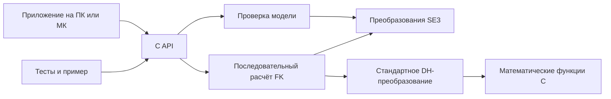
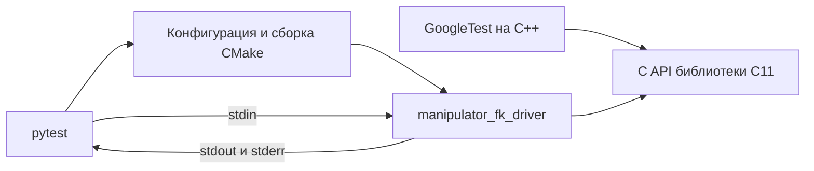

# Архитектура библиотеки прямой кинематики на C11

Статус: проект архитектуры, исходники ещё не реализованы. Основание — текущие требования пользователя и §1.1.1, с. 11–16 [пособия ИТМО](Modelirovanie_i_upravlenie_dvizheniem_robotov_-_ITMO.pdf). Этот документ задаёт текущий объём библиотеки. Прежние документы о C++17, обратной кинематике и системе управления описывают другой объём и не определяют требования первой версии.

## 1. Требования и принятые решения

| ID | Подтверждённое требование | Архитектурное следствие |
| --- | --- | --- |
| R-01 | Язык C11 | Публичные заголовки и ядро на стандартном C11, без расширений компилятора |
| R-02 | Только прямая кинематика | Конфигурация суставов преобразуется в позицию и ориентацию инструмента |
| R-03 | Настраиваемое число суставов, включая 3/4/5/6 | Число элементов передаётся во время вызова; алгоритм не содержит отдельных формул для каждого размера |
| R-04 | Интеграция в разные проекты, ПК и МК | Ядро не зависит от ОС, RTOS, транспорта или оборудования |
| R-05 | Без выделения памяти | Библиотека не вызывает malloc/calloc/realloc/free; все массивы предоставляет приложение |
| R-06 | Конкретного робота нет | Геометрия описывается данными модели, а не зашивается в код |
| R-07 | Точность и время расчёта пока не заданы | Проверяем численные свойства; бюджет времени и физическая точность устанавливаются для конкретной платформы и геометрии |
| R-08 | Модульные тесты через GoogleTest | C++-тесты вызывают публичный C API; библиотека продолжает собираться как C11 |
| R-09 | Интеграционные тесты через pytest с потоком stdin | CMake собирает тестовый executable; pytest управляет процессом и проверяет stdout, stderr и завершение |

Рабочие решения архитектора, которые можно пересмотреть до реализации:

- Поддерживается последовательная открытая цепь жёстких звеньев с вращательными и поступательными суставами, по одной независимой координате на сустав.
- Геометрия задаётся стандартными DH-параметрами. Замкнутые контуры, параллельные механизмы и упругие деформации требуют других моделей.
- Допускается любое положительное число суставов, ограниченное доступной памятью приложения и представимостью размеров в size_t. Проверки обязательно охватывают 3–6 и число больше 6.
- Базовый результат — однородное преобразование инструмента 4×4. Отдельная операция позволяет получить преобразования всех кадров цепи.
- Численный тип — double по умолчанию; float выбирается при сборке всей библиотеки и потребителя.
- База и инструмент имеют собственные фиксированные преобразования, по умолчанию единичные.
- Проверки модели выполняются при каждом публичном вычислении. Подготовленная модель с кэшированием — возможное расширение после измерений.
- Оба численных профиля входят в первую версию: IEEE 754 binary32 для float и binary64 для double, при условиях раздела 8. Это явная граница переносимости реализации C11.
- Получение всех кадров имеет гарантию сохранения выхода при ошибке и использует рабочий буфер вызывающего проекта.

Обратная кинематика, якобиан, динамика, траектории, регулятор, визуализация и протоколы не входят в первую версию. Небольшой пример и тесты служат документацией и проверкой библиотеки, а не отдельным прикладным продуктом.

## 2. Контекст и границы



Это зависимости исходного кода. Приложение владеет моделью, координатами и результатами. Библиотека выполняет синхронный расчёт и возвращает статус. Планирование частоты вызовов, синхронизация и доставка данных принадлежат приложению.

Обработка файлов, stdin/stdout, логирование, системные часы, потоки, UART/HAL, ROS, Modbus и сетевые библиотеки не входят в ядро. Для использования из C++ публичные заголовки предоставляют extern "C".

## 3. Математический контракт

Системы координат правые. Используются векторы-столбцы. Матрица T_parent_child переводит координаты из child в parent. Углы — радианы, линейные значения — метры. Хранение матрицы в памяти по строкам не меняет математическое соглашение о векторах-столбцах.

Модель одного сустава содержит тип, a, alpha, d_offset и theta_offset:

| Тип | theta | d | Единица q_i |
| --- | --- | --- | --- |
| Вращательный | theta_offset + q_i | d_offset | рад |
| Поступательный | theta_offset | d_offset + q_i | м |

Для каждого сустава:

```text
A_i = Rz(theta_i) Tz(d_i) Tx(a_i) Rx(alpha_i)

      [ cosθ  -sinθ cosα   sinθ sinα   a cosθ ]
A_i = [ sinθ   cosθ cosα  -cosθ sinα   a sinθ ]
      [ 0          sinα        cosα         d ]
      [ 0             0           0         1 ]

T_world_tool = T_world_base A_1 ... A_n T_last_tool
```

Нулевые и отрицательные DH-смещения допустимы. Длины физических деталей и смещения координатных систем — разные понятия. Геометрия конкретного робота должна переводиться в DH-таблицу с соблюдением правил присвоения осей из пособия.

Ориентация возвращается матрицей R: R^T R ≈ I, det(R) ≈ +1. Позиция находится в последнем столбце T. Углы Эйлера и кватернионы не входят в минимальный API; преобразования представлений можно добавить отдельным модулем без изменения FK.

Публичная матрица имеет размер 4×4, но композиция использует структуру жёсткого преобразования, а не общее умножение 4×4:

```text
R_result = R_parent_mid R_mid_child
p_result = R_parent_mid p_mid_child + p_parent_mid
last_row = (0, 0, 0, 1)
```

Последняя строка входа должна точно равняться (0,0,0,1); +0 и -0 принимаются как ноль. Даже небольшое отклонение отклоняется, а не исправляется скрыто. В каждом вычисленном кадре последняя строка задаётся точно. Допуски применяются только к ортонормальности и определителю R. Это исключает усиление отклонений последней строки при больших переносах.

FK не решает задачу достижимости и не требует обращения якобиана. Сингулярная поза сама по себе не является ошибкой FK. Ограничения суставов и столкновения относятся к проверке допустимости движения: первая версия вычисляет позу для любых конечных координат в рамках численного диапазона.

## 4. Модули и распределение ответственности

| Модуль | Ответственность | Граница |
| --- | --- | --- |
| types.h | Численный тип, статусы, типы данных и соглашения | Без реализации алгоритмов |
| transform.h / transform.c | Единичное преобразование, композиция и проверка SE(3) | Не знает DH и число суставов |
| model.h / model.c | Представление модели, инициализация, проверка суставов и базы/инструмента | Не выполняет обход FK |
| dh.c / dh_internal.h | Построение A_i по одной строке DH и координате | Внутренний модуль, не публичный механизм расширений |
| forward.h / forward.c | Обход цепи, проверка координат и запись результатов | Не управляет памятью приложения и устройствами |
| examples/ | Короткий пример использования API | Вывод результата вне ядра |
| tests/unit/ | GoogleTest: независимые эталоны и проверки C API | Не участвует в сборке прошивки |
| tests/driver/ | Перевод текстового потока в вызовы C API | Не содержит реализации FK |
| tests/integration/ | pytest: сборка и проверка настоящего процесса | Не использует ctypes и прямую загрузку библиотеки |

Внутренние функции не экспортируются как стабильный API. Один библиотечный target объединяет модули; отдельные библиотеки для каждого исходника не нужны. Общая внутренняя функция обхода обслуживает оба способа получения результата.

Предлагаемая структура:

```text
include/manipulator/
    config.h          # Конфигурация численного типа выбранной сборки
    types.h
    transform.h
    model.h
    forward.h
src/
    transform.c
    model.c
    dh.c
    dh_internal.h
    forward.c
examples/
    forward_example.c
tests/
    unit/
        test_transform.cpp
        test_model.cpp
        test_forward.cpp
    driver/
        forward_driver.c
    integration/
        conftest.py
        test_forward_stream.py
        test_build_package.py
        test_profile_mismatch.py
    embedded/
        smoke.c
        startup.c
        mps2_an386.ld
        README.md
    requirements.txt   # Зафиксированный pytest для тестового окружения
cmake/
    manipulatorConfig.cmake.in
    toolchains/
        arm_none_eabi.cmake
ci/
    test-toolchains.lock  # Точные версии compiler/libm/QEMU/test dependencies
CMakeLists.txt
```

## 5. Проект публичного API

Это эскиз контракта, не готовые заголовки. Все публичные имена имеют префикс mk_. Заголовки включают необходимые стандартные объявления самостоятельно.

```c
typedef double mk_real; /* либо float в конфигурации выбранной сборки */

typedef enum {
    MK_OK = 0,
    MK_INVALID_ARGUMENT = 1,
    MK_INVALID_MODEL = 2,
    MK_SIZE_MISMATCH = 3,
    MK_BUFFER_TOO_SMALL = 4,
    MK_NONFINITE_INPUT = 5,
    MK_NUMERIC_ERROR = 6,
    MK_INVALID_TRANSFORM = 7
} mk_status;

typedef enum {
    MK_REVOLUTE = 0,
    MK_PRISMATIC = 1
} mk_joint_type;

typedef struct {
    mk_real m[4][4];
} mk_transform;

typedef struct {
    mk_joint_type type;
    mk_real a;
    mk_real alpha;
    mk_real d_offset;
    mk_real theta_offset;
} mk_dh_joint;

typedef struct {
    const mk_dh_joint *joints;
    size_t joint_count;
    mk_transform world_base;
    mk_transform last_tool;
} mk_model;

mk_status mk_model_init(mk_model *out,
                        const mk_dh_joint *joints, size_t joint_count);
mk_status mk_model_validate(const mk_model *model);

mk_status mk_transform_identity(mk_transform *out);
mk_status mk_transform_validate(const mk_transform *transform);
mk_status mk_transform_compose(const mk_transform *parent_mid,
                               const mk_transform *mid_child,
                               mk_transform *out);

mk_status mk_forward(const mk_model *model,
                     const mk_real *q, size_t q_count,
                     mk_transform *world_tool);

mk_status mk_forward_frames(const mk_model *model,
                            const mk_real *q, size_t q_count,
                            mk_transform *frames, size_t frame_capacity,
                            mk_transform *workspace, size_t workspace_capacity);
```

mk_model_init проверяет таблицу, сохраняет заимствованный указатель и устанавливает единичные базу/инструмент. Объект модели записывается только при успехе. Для задания базы и инструмента приложение меняет соответствующие поля и может вызвать mk_model_validate. Публичные вычисления всё равно проверяют модель; наличие вызова init не является скрытым условием безопасности.

mk_forward возвращает одну позу. mk_forward_frames записывает ровно n+2 кадров:

- frames[0] = T_world_base;
- frames[i] = T_world_base A_1 ... A_i для i = 1..n;
- frames[n+1] = T_world_tool, включая инструмент.

frame_capacity и workspace_capacity измеряются в элементах mk_transform. Обе ёмкости должны быть не меньше n+2. Размер больше необходимого допустим; хвост каждого буфера не изменяется. Отдельного результата инструмента в mk_forward_frames нет, потому что он уже находится в последнем кадре. Перед обходом проверяются переполнение n+2 и представимость размеров объектов: n*sizeof(mk_dh_joint), n*sizeof(mk_real), (n+2)*sizeof(mk_transform). Проверки выполняются через деление предела SIZE_MAX, до опасных сложений/умножений.

Все публичные функции проверяют свои входы; внутренние функции работают с уже проверенными данными. mk_transform_compose проверяет оба входных преобразования и результат. Она возвращает MK_INVALID_TRANSFORM при некорректном конечном входе, MK_NONFINITE_INPUT при NaN/Inf и MK_NUMERIC_ERROR при отказе вычисления или нарушении инвариантов результата. mk_transform_validate использует те же правила проверки входа. mk_model_validate и FK передают MK_INVALID_TRANSFORM для неверной базы/инструмента, а MK_INVALID_MODEL — для структуры модели и типов суставов. mk_transform_identity проверяет указатель и записывает точную единичную матрицу.

## 6. Владение, время жизни и ошибки

Модель заимствует массив joints, но хранит базу и инструмент по значению. Массив суставов должен жить не меньше всех вызовов с этой моделью. q и выходные буферы нужны только на время вызова. Приложение может хранить всё статически, на стеке или в собственной арене: библиотека не требует какого-либо конкретного способа размещения.

Проверяются указатели, joint_count > 0, точное равенство q_count и joint_count, ёмкости, типы суставов, конечность чисел и корректность SE(3). Проверка SE(3) включает конечность элементов, точную последнюю строку (0,0,0,1), ортонормальность R и положительный единичный определитель в пределах допуска раздела 8. До произведений для R^T R и det(R) проверяется |R_ij| <= 1+tau_R: конечная матрица с огромными элементами отклоняется без переполнения в самой валидации. Отражение, масштаб и сдвиг формы не принимаются за позу.

Правила статусов:

| Статус | Значение |
| --- | --- |
| MK_INVALID_ARGUMENT | Обязательный указатель NULL |
| MK_INVALID_MODEL | Пустая цепь, неизвестный тип сустава или непредставимый размер модели |
| MK_INVALID_TRANSFORM | Конечная входная матрица нарушает контракт жёсткого преобразования, включая базу/инструмент |
| MK_SIZE_MISMATCH | Размер q отличается от числа суставов |
| MK_BUFFER_TOO_SMALL | Недостаточная ёмкость массива кадров или workspace |
| MK_NONFINITE_INPUT | NaN/Inf во входной геометрии, матрицах или q |
| MK_NUMERIC_ERROR | Проверка диапазона предотвращает опасную операцию; результат нечисловой или нарушает инварианты вращения |

Если нарушено несколько условий, функция возвращает первую обнаруженную ошибку; порядок не является частью API. Статус не передаётся через errno. assert допускается только для внутренних инвариантов и не заменяет публичные проверки.

Все функции с выходным результатом сохраняют его при любом возвращаемом статусе ошибки. mk_forward и mk_transform_compose сначала вычисляют результат во временную матрицу. mk_transform_compose допускает out, совпадающий с одним из входов; произвольное частичное перекрытие объектов не допускается. Модель, joints и q не должны пересекаться с выходными буферами FK. frames и workspace — два отдельных непересекающихся массива, не пересекающихся также с входами. Это предусловие контракта, не обещание обнаружить произвольное перекрытие указателей.

mk_forward_frames сначала проверяет весь вход и вычисляет все n+2 кадров в workspace. Только после полного успеха копирует их в frames. При любой ошибке frames остаётся прежним; вычисленная часть workspace не имеет контрактного значения и не используется приложением как результат. Для ошибочных указателей/ёмкостей и некорректных входных данных workspace также не изменяется. Гарантия записи только при успехе относится к завершённому вызову, а не к атомарности memcpy относительно других потоков или аппаратной неисправности.

C API не может проверить, что переданный указатель действительно адресует заявленное число доступных элементов. Корректные адреса, размеры выделенных объектов и время жизни — ответственность вызывающего кода.

## 7. Алгоритм и ресурсы

Публичный вызов проверяет модель и координаты, после чего начинает с T_world_base и последовательно компонует накопленное преобразование с A_i через R/p. В конце применяется T_last_tool. Перед потенциально переполняющимися арифметическими операциями проверяется диапазон; после вычислительных шагов — конечность результата и инварианты вращения. Внутри ядра используются только временные матрицы фиксированного размера. При выдаче кадров промежуточные результаты хранятся во внешнем workspace.

| Ресурс | Только инструмент | Все кадры |
| --- | --- | --- |
| Время, включая валидацию | O(n) | O(n) |
| Внутренняя рабочая память | O(1) | O(1) |
| Память модели у приложения | O(n) | O(n) |
| Выходной буфер у приложения | Одна матрица | n+2 матриц |
| Рабочий буфер у приложения | Не требуется | n+2 матриц |
| Выделения памяти | 0 | 0 |

Нет VLA, рекурсии, массивов размера n внутри ядра и изменяемых глобальных переменных. Внутренний стек ограничен независимо от числа суставов. Точный размер стека зависит от компилятора и реализации libm; его измеряют при реализации, включая вызываемые математические функции.

Алгоритм имеет фиксированное число шагов по длине цепи; это не гарантия hard real-time на любой платформе. Синхронный интерфейс достаточен для FK: пошаговый решатель, отмена, очереди и фоновые потоки здесь не требуются. Приложение устанавливает допустимую длину цепи и частоту вызовов исходя из своего бюджета.

Вызовы реентерабельны: неизменяемую модель можно читать одновременно, если q и выходы корректно принадлежат каждому вызову, а математическая библиотека платформы допускает такой режим. Изменять joints, модель или q во время чтения нельзя. Библиотека не ставит блокировки. Наличие const-указателя не обеспечивает синхронизацию само по себе.

## 8. Численная политика и переносимость

### Арифметический профиль

Первая версия поддерживает binary32 для float и binary64 для double: CHAR_BIT=8, FLT_RADIX=2, FLT_MANT_DIG=24, FLT_MIN_EXP=-125, FLT_MAX_EXP=128, DBL_MANT_DIG=53, DBL_MIN_EXP=-1021, DBL_MAX_EXP=1024, sizeof(float)=4 и sizeof(double)=8. Проверки конфигурации и _Static_assert отклоняют несовместимые представления. Совпадение этих параметров необходимо, но само по себе не доказывает семантику IEC 60559.

Поддерживаемая платформа должна обеспечивать IEEE 754 арифметику с округлением к ближайшему, отключёнными ловушками и без flush-to-zero/denormals-are-zero. Поддерживаются quiet NaN/Inf для проверки ошибочного ввода; signaling NaN не входит в контракт. Семантика подтверждается документацией toolchain/runtime и smoke-тестами. Отсутствие __STDC_IEC_559__ не является автоматическим отказом, но требует отдельного подтверждения профиля; неподтверждённая платформа не заявляется поддерживаемой. Это ограничения runtime, а исходный код остаётся C11.

Приложение обеспечивает этот режим на время вызова. Ядро не меняет режим округления, FPU control register или флаги исключений. Флаги, поставленные вычислениями, могут сохраняться после вызова; библиотека не обещает полного отсутствия побочных эффектов floating-point environment. Базовый C11 без соответствующих условий не гарантирует обработку переполнения через Inf: см. [N1570, §6.5 и приложение F](https://open-std.org/jtc1/sc22/wg14/www/docs/n1570.pdf).

### Предотвращение численных отказов

Внутренние функции checked_add/checked_mul проверяют диапазон перед сложением смещения с q, умножением координат и суммированием членов композиции. Предел — FLT_MAX или DBL_MAX выбранного профиля. Проверки консервативны: допустим отказ MK_NUMERIC_ERROR около предела представимости, даже если итоговое выражение с взаимным сокращением могло бы поместиться в тип. Опасная операция не выполняется. Результат дополнительно проверяется на конечность; тесты охватывают одинаковые/разные знаки, значения рядом с MAX и субнормальные числа.

Валидация SE(3) сначала исключает NaN/Inf, проверяет точную последнюю строку и ограничивает |R_ij| <= 1+tau_R. Затем проверяет max_ij |(R^T R-I)_ij| <= tau_R и |det(R)-1| <= tau_R. Числовые границы элементов R предотвращают переполнение произведений в этих проверках. Перенос проверяется на конечность, а его вычисление использует checked-операции.

Каждый вычисленный кадр проходит те же проверки R и точной последней строки, что и входная матрица. Нарушение результатом этих условий даёт MK_NUMERIC_ERROR, а не MK_INVALID_TRANSFORM. Ортонормализация не выполняется. Таким образом, успешный результат можно снова передать операциям с преобразованиями; составление почти предельных приближённых матриц может завершиться численной ошибкой, если их совместная погрешность превысит допуск.

### Численная приёмка

Ниже зафиксированы начальные критерии приёмки реализации. Это выбранные проектом пороги, а не уже измеренная точность и не точность реального робота. Их ослабление требует отдельного обоснования и изменения документа; подгонять тест к ошибочной реализации нельзя.

| Проверка | double / binary64 | float / binary32 |
| --- | --- | --- |
| tau_R: валидация входного/выходного R | 2e-12 | 2e-5 |
| Максимальная абсолютная ошибка элемента R для контрольных моделей | 2e-12 | 2e-5 |
| atol позиции, коэффициент масштаба S | 5e-12 | 5e-5 |
| rtol позиции | 5e-13 | 5e-6 |
| Последняя строка каждого кадра | Точное (0,0,0,1) | Точное (0,0,0,1) |

Для позиции применяется max_j |p_j-p_ref,j| <= atol*S + rtol*max_j |p_ref,j|, где S = max(1 м, сумма |a_i|+|d_i(q_i)| плюс 1-нормы переносов базы и инструмента). Масштаб рассчитывается в эталоне повышенной точности, вне production-кода. Это предотвращает некорректное использование только относительной ошибки около нулевой позиции.

Контрольная область: n = 1,3,4,5,6,7,16,64; |a_i|, |d_offset_i|, |q_i| поступательного сустава и компоненты переносов базы/инструмента не больше 10 м; |alpha_i| и |theta_offset_i| не больше pi; |q_i| вращательного сустава не больше 2*pi. Проверяются знаковые и нулевые смещения, смешанные суставы, выпрямленные и сложенные цепи, взаимное сокращение переносов и пространственные повороты. Основные эталоны используют точные геометрические модели; приближённые входные матрицы с ошибкой около tau_R проверяются отдельно как тесты валидации и композиции.

Область тестовой приёмки не является ограничением числа суставов API. Дополнительные проверки n=1024 исследуют накопление ошибки: ожидается либо результат, удовлетворяющий инвариантам, либо MK_NUMERIC_ERROR, без повреждения выходов. За контрольной областью гарантируются проверки статусов и инвариантов при успехе, но не универсальная погрешность позиции. Большие углы не нормализуются скрыто; качество тригонометрии зависит от libm, поэтому отдельно проверяются углы до 1e6 рад и записываются результаты, без обещания общего допуска для любых конечных углов.

### Сборка и математический runtime

При float используются sinf/cosf, при double — sin/cos. Ядро требует stddef.h, stdint.h, limits.h, float.h, math.h и string.h; последнее необходимо для записи готового результата из workspace. Freestanding C11 не гарантирует наличие всех этих функций: toolchain/runtime проекта предоставляет их совместимые реализации. Ядро не требует POSIX или ОС.

fast-math/finite-math-only и небезопасное изменение округлений запрещены, включая флаги, унаследованные из родительской сборки. Для GCC/Clang наличие __FAST_MATH__ или ненулевого __FINITE_MATH_ONLY__ вызывает ошибку компиляции ядра; прочие toolchain проходят отдельную проверку параметров. LTO также должен соблюдать арифметический профиль. Причина запрета описана в [документации GCC](https://gcc.gnu.org/onlinedocs/gcc/Optimize-Options.html): оптимизации могут считать NaN/Inf невозможными. Проверки отрицательной сборки и smoke-тесты обязательны.

### Защита совместимости профиля

mk_real и layout структур различаются между float/double. Публичные функции имеют реальные экспортируемые имена с версией ABI и профилем: mk_v1_f32_forward и mk_v1_f64_forward; аналогично именуются все остальные функции. Заголовок выбранной сборки отображает удобные mk_* имена на свой набор символов. Общих непрофилированных экспортируемых aliases нет.

```c
/* Пример для config.h сборки binary32; все функции отображаются аналогично. */
#define mk_forward mk_v1_f32_forward
#define mk_forward_frames mk_v1_f32_forward_frames
```

Установленный config.h генерируется для конкретного профиля и запрещает конфликтующий override. Профиль распространяется через CMake target, а имя артефакта содержит f32/f64. Заголовки f32 с библиотекой f64 и наоборот должны давать ошибку линковки, а не запускать код с неверным размером буфера. Это проверяется негативными интеграционными тестами, которые действительно вызывают API. Версия ABI меняется при несовместимых изменениях. Смешивание разных ABI одного toolchain, например soft/hard float или packing flags, также не допускается; тестовое окружение фиксирует параметры сборки. Одновременное подключение обоих профилей в один исходный файл пока не поддерживается.

## 9. SOLID применительно к C

| Принцип | Применение | Проверяемое следствие |
| --- | --- | --- |
| S — одна ответственность | Геометрия, проверки SE(3), локальная DH-матрица и обход цепи разделены | Изменение ввода приложения не затрагивает математику |
| O — расширяемость | Число суставов, DH-таблица, база и инструмент являются данными | Новая геометрия и цепь из 7 суставов не требуют изменения FK |
| L — взаимозаменяемость | float/double-профили и будущие реализации соблюдают одинаковые логические контракты | На каждом профиле выполняется общий набор проверок с собственными численными допусками |
| I — небольшие интерфейсы | Работа с преобразованиями, моделью и FK разделена; поза инструмента и массив кадров — отдельные операции | Потребитель одной позы не обязан предоставлять буфер всех кадров |
| D — направление зависимостей | Приложение зависит от чистого C API; ядро принимает данные и не обращается к инфраструктуре | FK тестируется и вызывается без ОС, драйверов, транспорта и консоли |

LSP относится прежде всего к подтипам, которых здесь нет; строка L задаёт аналогичный контракт для вариантов реализации, а не имитирует наследование. DIP здесь выражен границей библиотеки и отсутствием зависимости ядра от инфраструктуры. Прямой вызов libm допустим; таблица callback-функций для каждой математической операции пока не нужна.

OCP не обещает добавление любого нового механизма без изменения кода. Новый тип кинематической пары или замкнутые ограничения требуют нового алгоритма и явного пересмотра API. Для заранее известных R/P используется enum и закрытая внутренняя диспетчеризация. Плагины, vtable и универсальная иерархия суставов не обоснованы текущими требованиями.

## 10. Практики проектирования системы

- Граница системы соответствует задаче: одна синхронная вычислительная библиотека. Её масштабирование определяется длиной цепи и ресурсами вызывающего проекта.
- Модули разделяются по скрываемым решениям: представление модели, формула DH, операции преобразований. Внутреннее устройство можно менять при сохранении публичных контрактов.
- Небольшое число стабильных публичных функций, явные размеры и владение памятью облегчают интеграцию и аудит.
- Данные модели отделены от изменяемой конфигурации q. Одну геометрию можно использовать для множества расчётов без копирования таблицы.
- Ошибка расчёта передаётся вызывающему коду. Вывод, телеметрия и политика реакции остаются в приложении.
- Оптимизации вводятся по измерениям. Предвычисление sin(alpha), cos(alpha), компактное хранение 3×4 и подготовленная модель рассматриваются только после профилирования и оценки памяти.
- Совместимость проверяется на границе потребителя: сборка C/C++, установка пакета и подключение внешнего проекта.

Подход к сокрытию решений опирается на [работу Д. Парнаса о декомпозиции модулей](https://doi.org/10.1184/r1/6607958). Правила установки и распространения требований сборки — на [CMake Packages](https://cmake.org/cmake/help/latest/manual/cmake-packages.7.html).

## 11. Сборка, поставка и версии

Основной target — manipulator_kinematics, импортируемое имя — manipulator::kinematics. На диске имя библиотеки содержит численный профиль, например manipulator_kinematics_f64. MK_REAL_TYPE принимает только float или double; config.h и имена экспортов выбираются согласованно. По умолчанию статическая библиотека, shared-вариант возможен на поддерживающих его платформах. Поддерживаются add_subdirectory и установленный CMake package через find_package. Для собственной embedded-системы сборки достаточно публичных заголовков, config.h выбранного профиля и файлов src; CMake не является runtime-зависимостью.

Требование C11 задаётся target properties без расширений. Предупреждения для GCC/Clang — Wall, Wextra, Wpedantic; MSVC получает свой профиль. Предупреждения и настройки тестов не распространяются принудительно на чужой проект. Зависимость от libm связывается там, где toolchain требует отдельную математическую библиотеку. Библиотека не скачивает зависимости при сборке.

Host-тесты и пример отключаемы и не требуются при cross-compilation ядра. Опции MK_BUILD_UNIT_TESTS и MK_BUILD_TEST_DRIVER независимы и по умолчанию выключены при включении библиотеки в чужой проект. CXX включается только для GoogleTest; ядро и потоковый адаптер собираются C-компилятором в режиме C11. GoogleTest предоставляется установленным пакетом через find_package(GTest CONFIG REQUIRED); его версия фиксируется в тестовом окружении. Никаких неявных загрузок зависимостей при конфигурации. Cross-toolchain и linker script предоставляет приложение. Установка экспортирует target и заголовки с относительными путями без привязки к машине разработчика.

До стабилизации — версия 0.x с явно отмеченными изменениями API. После 1.0 изменение соглашений, единиц, кодов ошибок или layout публичных структур требует major-версии. Совместимость бинарных файлов между разными компиляторами и архитектурами не обещается. Публичные структуры не являются форматом файлов или сетевой сериализации. Лицензия библиотеки выбирается отдельно до внешнего распространения; лицензия пособия не переносится автоматически на собственный код.

## 12. Приёмка реализации

| Область | Проверки |
| --- | --- |
| Математика | Ручные примеры переноса/вращения; планарная цепь с независимыми тригонометрическими формулами; пространственная цепь с ненулевыми alpha |
| Размер | 1, 3, 4, 5, 6, 7, 16, 64; n=1024 для накопления ошибки; тот же алгоритм |
| Суставы | R, P и смешанная цепь; знак координат; theta_offset и d_offset |
| Кадры | Поворот и перенос базы; локальное смещение инструмента; промежуточные кадры; последний кадр совпадает с одиночным FK |
| SE(3) | R^T R, det(R), точная последняя строка; отражение, масштаб, большие элементы R и даже малые отклонения последней строки отклоняются |
| Контракты | NULL, пустая цепь, неверный enum, размеры, обе ёмкости, NaN/Inf, предотвращение переполнения; выход сохраняется при любом отказе, включая ошибку на последнем звене |
| Память | Отсутствие allocator-вызовов, VLA и рекурсии в ядре; охранные элементы выходных буферов; отсутствие записи в входы |
| Профили | double и float; Debug и Release; ошибки проверяются и при NDEBUG |
| Интеграция | Самодостаточные заголовки, C++-потребитель, add_subdirectory, установленный пакет, отрицательные сборки с несовместимыми профилями и fast-math |
| Инструменты | GCC/Clang на host, sanitizers; обязательные cross-link и smoke в QEMU; стек/время на реальном МК после его выбора |

Ожидаемые позиции и ориентации в основных математических тестах выводятся независимо от production-кода DH. Сравнение двух функций, использующих один обход, служит проверкой контрактов, но не заменяет независимый математический эталон. Модульные тесты используют GoogleTest, включая ASSERT/EXPECT и параметризацию. Обычный C assert не является тестовым фреймворком; проверки выполняются также при NDEBUG. pytest использует собственные проверки и диагностирование результатов процесса.

По результатам реализации фиксируются размеры типов и рабочей памяти, версии toolchain, численные допуски и время расчёта для тестируемых n. До выбора МК архитектура подтверждает отсутствие привязки к платформе, а не измеренные показатели на любом оборудовании.

## 13. Архитектура тестирования



### Модульные тесты

Target manipulator_unit_tests связывается с manipulator::kinematics и GTest::gtest_main. Через gtest_discover_tests проверки регистрируются в CTest. C++17 применяется только к тестовому target в соответствии с [требованиями GoogleTest](https://google.github.io/googletest/quickstart-cmake.html); .c исходники ядра не компилируются как C++.

Все модульные проверки используют публичный API. Наборы тестов разделены по ответственности модулей. Небольшие аналитические эталоны, границы буферов, статусы ошибок и неизменность данных проверяются непосредственно. Моки не нужны: у вычислительного ядра нет внешних устройств и сервисов. Сборка C++-тестов дополнительно проверяет корректность extern "C".

### Потоковый тестовый адаптер

Target manipulator_fk_driver — тонкий C11 executable для host-интеграции. Его протокол служит тестам и не является публичным транспортным API библиотеки. У адаптера собственная проверка синтаксиса, а у библиотеки — проверка математических входов.

Рабочий формат — одна ASCII-строка на запрос, числа с точкой в C locale. Каждый запрос полностью задаёт модель и координаты; состояние предыдущего запроса не наследуется:

```text
FK n [type a alpha d_offset theta_offset q]×n [world_base]×16 [last_tool]×16
```

type — ровно R или P, команда — ровно FK. n соответствует [1-9][0-9]* без знака и ведущих нулей. Превышение SIZE_MAX или вместимости адаптера даёт REQUEST_TOO_LARGE до формирования массивов; неподходящая запись целого — PARSE_ERROR. Матрицы передаются построчно. Разделители токенов — ASCII space и tab; они допускаются также в начале/конце строки. Метры и радианы соответствуют C API. В первой версии адаптер вызывает mk_forward; промежуточные кадры покрываются GoogleTest.

Конечный числовой токен соответствует грамматике:

```text
[+-]?( [0-9]+(\.[0-9]*)? | \.[0-9]+ )([eE][+-]?[0-9]+)?
```

Пробелы в этом описании групп — только для чтения и не входят в токен. Разрешены 1, -0.5, .25, 1., +2e-3. Шестнадцатеричные float, запятая, суффиксы f/F, внутренние пробелы и частично разобранные токены запрещены. Дополнительные специальные токены — ровно nan, inf, +inf, -inf; они передаются API и приводят к MK_NONFINITE_INPUT. NAN, infinity и nan(payload) не входят в грамматику.

Адаптер сначала проверяет грамматику, затем вызывает strtof для f32 или strtod для f64 непосредственно, без промежуточного приведения double к float. Перед преобразованием обнуляет errno, проверяет полный разбор и ERANGE. Переполнение или потеря диапазона при underflow дают NUMBER_RANGE_ERROR; такой запрос не передаётся API. В частности, 1e100 даёт NUMBER_RANGE_ERROR в f32 и проходит текстовый разбор в f64; 1e-100 даёт ошибку диапазона в f32. Даже если libm возвращает субнормальный результат с ERANGE, адаптер отклоняет его по этой политике. Поддержка субнормальных координат самого C API проверяется в GoogleTest без текстового парсера. Пустой/лишний/повреждённый токен — PARSE_ERROR. При нескольких нарушениях порядок выбора ошибки не закреплён.

Ответ на каждый запрос — ровно одна строка:

```text
OK [world_tool]×16
ERR MK_INVALID_MODEL
ERR PARSE_ERROR
ERR REQUEST_TOO_LARGE
ERR NUMBER_RANGE_ERROR
```

При ошибке C API возвращается символическое имя его статуса. Ошибки синтаксиса, числового диапазона текста и ресурсов адаптера имеют отдельные имена; они не расширяют enum библиотеки. Точность печати — FLT_DECIMAL_DIG для f32 и DBL_DECIMAL_DIG для f64; формат %g получает double-аргумент, включая стандартное продвижение float. Числа разделяются одним пробелом, строки завершаются LF; в Windows text mode допустимо системное преобразование в CRLF. Это позволяет сохранить значение при обратном чтении. stdout не содержит приглашений или логов; stderr предназначен для фатальной диагностики процесса. Драйвер явно устанавливает LC_NUMERIC в C locale и не зависит от окружения процесса.

Для адаптера принимается настраиваемая при сборке вместимость 64 сустава и ограничение строки 64 КиБ. Это пределы тестовой оболочки, не ограничения библиотеки. Буферы адаптера фиксированы; VLA и heap не нужны. Слишком длинная строка дочитывается до разделителя и получает один ответ об ошибке. Следующий запрос обрабатывается независимо. Бинарные/NUL-байты вне ASCII-грамматики отклоняются.

Поддерживаются LF и CRLF. Пустая строка — PARSE_ERROR. Последняя непустая строка без перевода строки обрабатывается при EOF. После каждой строки ответа выполняется fflush(stdout), чтобы pytest мог проверить интерактивный обмен до закрытия stdin.

Ошибочный запрос не завершает процесс: адаптер выдаёт ERR и продолжает чтение. Чистый EOF даёт exit code 0, даже если отдельные запросы были ошибочны. Ошибка чтения/записи или внутренняя фатальная ошибка даёт ненулевой код. Поэтому pytest проверяет и ответы запросов, и статус процесса; одного returncode == 0 недостаточно.

### Интеграционные тесты pytest

Session-scoped [fixture pytest](https://docs.pytest.org/en/stable/how-to/fixtures.html) создаёт временный каталог сборки, запускает cmake -S/-B, затем cmake --build с target manipulator_fk_driver и возвращает путь к настоящему бинарнику. Профили float/double получают разные каталоги. В CI разрешён явный --driver-path к уже собранному бинарнику, чтобы не повторять сборку. Этот режим не заменяет отдельные проверки конфигурации и сборки CMake.

Fixture обрабатывает single- и multi-config генераторы: конфигурация Release/Debug и расположение .exe не зашиваются как build/driver. Путь определяется по метаданным target, записанным CMake для выбранной конфигурации. Команды запускаются списком аргументов без shell=True. Ошибка конфигурации или сборки означает падение тестовой сессии, а не skip.

Обычные сценарии используют subprocess.run с input, capture_output и timeout. Потоковые сценарии используют Popen: отправляют запрос фрагментами, получают ответ до EOF, затем отправляют следующий. stdout и stderr читаются отдельными reader-потоками, передающими ограниченные результаты в очередь; ожидание строки выполняется через очередь с тайм-аутом, а не блокирующий readline в главном потоке. Это работает также в Windows, где select для subprocess pipes не является переносимым решением. Объём полученного вывода ограничен, чтобы неожиданная бесконечная печать не исчерпала память тестов. Cleanup сначала terminate, затем при необходимости kill, затем wait и завершение reader-потоков; закрытие буферизованных потоков не должно блокировать cleanup раньше остановки процесса. Тайм-аут — защита тестов от зависания, а не установленный пользователем бюджет времени FK.

Обязательные интеграционные сценарии:

- Один запрос: независимая ожидаемая позиция и ориентация, 16 конечных чисел в ответе.
- Несколько запросов в одном stdin: точное число ответов и сохранение порядка.
- Валидный → ошибочный → валидный запрос: восстановление после ошибки, без наследования модели.
- Различные n, R/P, база и инструмент; одинаковый логический результат для float/double в своих допусках.
- EOF, последняя строка без LF, CRLF, пустая/обрезанная строка, лишние поля и нечисловые токены.
- NaN/Inf, запрещённые числовые записи, overflow/underflow strtof/strtod, слишком большая строка и модель сверх вместимости адаптера.
- Ответ до закрытия stdin; корректная обработка запроса, поступающего по частям.
- stdout без постороннего текста, ожидаемый stderr и exit code, отсутствие зависания.
- Установленный CMake package и внешний C11-потребитель; сборка ядра при выключенных тестах без C++ и Python; вызов f32-API с f64-библиотекой и наоборот обязан не пройти линковку.

Python-эталоны используют независимые геометрические формулы для контрольных моделей. pytest не вызывает библиотеку напрямую и не повторяет DH production-алгоритм как единственный источник ожидаемых значений.

Единый запуск разработки: CMake собирает unit target и driver; CTest запускает GoogleTest; python -m pytest запускает интеграционные тесты. В CI обязательны оба этапа. pytest не запускает CTest рекурсивно. GoogleTest и pytest являются зависимостями тестового окружения, не поставляемого ядра. Фактические версии и команды будут закреплены при реализации.

### Обязательная embedded-проверка

Базовая проверяемая платформа — Cortex-M4 через arm-none-eabi-gcc, GNU Arm linker и newlib, с -mcpu=cortex-m4 -mthumb -mfloat-abi=soft. Software floating point выбирается для первой cross-проверки, чтобы работоспособность не зависела от наличия и инициализации FPU. Ядро, runtime и smoke-программа используют согласованный ABI; [GCC отдельно отмечает несовместимость soft/hard float ABI](https://gcc.gnu.org/onlinedocs/gcc/ARM-Options.html).

Точный выпуск compiler/binutils/newlib, образ CI и версия QEMU фиксируются при реализации в ci/test-toolchains.lock; использование latest не считается воспроизводимой проверкой. Собственный toolchain-файл задаёт compiler и static-library try_compile. Затем отдельно требуется линковка полного smoke ELF: одного успешного создания .a недостаточно для проверки наличия sin/cos и runtime.

Smoke содержит минимальный startup, таблицу векторов и linker script для памяти MPS2 AN386. Всё это находится в tests/embedded и не добавляется в ядро. ELF запускается под [QEMU mps2-an386, моделирующим Cortex-M4](https://www.qemu.org/docs/master/system/arm/mps2.html). Результат передаётся host через отдельный адаптер smoke-программы; она не использует printf или malloc и не требует GoogleTest на устройстве. pytest запускает сборку и QEMU subprocess с тайм-аутом, проверяет маркер завершения/код и отсутствие fault. Интерактивный stdin-протокол host-драйвера остаётся отдельной проверкой.

Для обоих профилей обязательны:

- Успешный cross-link с реально используемыми sin/cos или sinf/cosf и копированием из workspace.
- Ручные контрольные модели 3/6R и смешанная R/P-цепь, база/инструмент, ошибки входа и сохранение выходов.
- Проверки binary32/binary64, quiet NaN/Inf, округления и субнормальных значений; тестовый runtime должен соответствовать разделу 8.
- Link map, nm/objdump и проверка достижимых зависимостей ядра: отсутствуют malloc/calloc/realloc/free, _sbrk и их внутренние allocator-аналоги, а также зависимости ядра от I/O. Диагностика smoke исключается из этого анализа явно.
- Отчёт -fstack-usage по ядру; отсутствуют динамические/VLA stack frames. Высокая отметка стека smoke измеряется заполнением выделенной области шаблоном, включая вызываемые libm/runtime функции; n=3/6/64 не должен создавать линейный рост внутреннего стека ядра. Массивы приложения размещаются отдельно и не смешиваются с этой оценкой.
- Сохранение ELF, map, отчёта размеров секций, stack-отчётов и результата QEMU как CI artifacts.

Embedded-job обязателен для приёмки, а отсутствующий cross-toolchain или QEMU в CI является ошибкой окружения, не основанием пропустить тест. Локальная host-сборка может выполняться без них, но не подтверждает embedded-приёмку. QEMU проверяет запуск и арифметику; время выполнения и WCET на реальном МК по эмулятору не заявляются.

## 14. Порядок реализации и открытые вопросы

1. Зафиксировать заголовки и контракт владения, собрать C11-ядро и минимального внешнего потребителя.
2. Реализовать преобразования и проверку модели с независимыми тестами.
3. Реализовать один обход FK и две публичные операции выдачи результата.
4. Проверить численные профили и отрицательные случаи через GoogleTest; собрать потоковый адаптер и проверить его через pytest, включая интеграцию пакета, несовместимые профили и ошибки диапазона текста.
5. Выполнить обязательные cross-link и QEMU smoke для обоих профилей, проверить allocator-зависимости и стек согласно разделу 13.
6. Документировать запуск примера и фактические ограничения; после выбора реального МК измерить бюджет ресурсов.

Открыты конкретный реальный МК, физическая точность и частота вызовов, лицензия. Оба численных профиля, программные критерии точности и базовая эмулируемая embedded-платформа уже зафиксированы архитектурой. Эти решения не подменяют аппаратные требования пользователя. При переходе к реализации рабочие решения раздела 1 остаются явно отличимыми от подтверждённых требований.

## 15. Закрытие архитектурного ревью

Ниже «закрыто» означает, что решение и проверка закреплены в архитектуре; реализация и результаты тестов ещё отсутствуют.

| Замечание | Принятое исправление | Проверка реализации |
| --- | --- | --- |
| Смешивание float/double | Разные экспортируемые символы с профилем и версией ABI | Отрицательная линковка в обе стороны |
| Отклонение последней строки | Точная входная строка; композиция R/p; точная выходная строка | Ненулевой epsilon в строке отклоняется, большие переносы не меняют её |
| Обнаружение переполнения после операции | Явный IEEE/runtime профиль, checked-операции, границы R перед валидацией | MAX, субнормальные числа, огромные конечные R, несовместимые флаги сборки |
| Отсутствие численных критериев | Допуски, масштаб позиции и контрольная область раздела 8 | Оба профиля, n до 64, независимые эталоны |
| Неполный контракт compose | Проверка обоих входов/результата и MK_INVALID_TRANSFORM | Полная матрица ошибок каждого публичного вызова |
| Частично записанные кадры | Внешний workspace и запись frames только при успехе | Sentinel-буфер остаётся прежним при отказе на любом шаге |
| Неопределённый разбор чисел | Строгая грамматика, strtof/strtod, NUMBER_RANGE_ERROR | Записи, специальные токены, overflow/underflow и восстановление потока |
| Только косвенная переносимость на МК | Обязательные Cortex-M4 cross-link, QEMU smoke и анализ runtime | ELF/map/stack artifacts, проверка обоих профилей |
