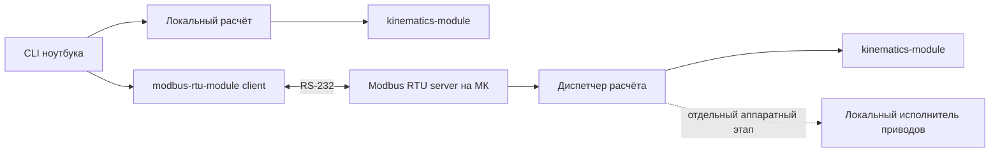

# Портируемые модули для микроконтроллера

Статус: проектное направление по предложению пользователя, без реализации прошивки. Обязательная консольная версия сохраняется. ROS 2 не требуется. Кинематическое ядро и Modbus RTU оформляются как независимые переносимые модули: приложение подключает их как git submodule и задаёт конфигурацию. Выбор конкретного МК, приводов и электрического интерфейса пока открыт.

## Два места выполнения одной модели

1. **Локальный режим:** CLI → модуль кинематики → углы и рассчитанная позиция. Это текущая учебная версия.
2. **Расчёт на МК:** CLI → модуль Modbus RTU → приложение МК → подключённый модуль кинематики. Ноутбук вводит цель и читает результат; МК самостоятельно решает IK.

Модули не являются частью конкретного приложения и не содержат `main`, CLI, ROS, HAL или драйверов приводов. Приложение на ноутбуке и приложение на МК подключают те же submodule. Удалённый расчёт и движение приводов — разные прикладные функции: Modbus-модуль лишь доставляет команды и результаты.



Это схема исполнения, а не зависимостей: математическая библиотека не включает заголовки CLI, Modbus, UART/HAL или приводов. Протокол не вызывает решатель из ISR. Обработчик UART принимает байты в ограниченный буфер; разбор запросов и математический расчёт выполняются в основном цикле или отдельных задачах при наличии RTOS. RTOS не является обязательной зависимостью.

## Контракт модулей

`kinematics-module` предоставляет конфигурацию модели, `forward_kinematics`, `jacobian_position`, `solve_step`/`solve` и типизированный `SolveResult`. Конфигурация содержит DH-параметры, базу, инструмент, число суставов и численные настройки. Модуль не хранит глобальную модель: экземпляр создаётся приложением и получает конфигурацию явно. Решатель не знает, вызван ли он из CLI, прошивки или теста.

`modbus-rtu-module` состоит из чистого кодека кадра, конечного автомата client/server и транспортного интерфейса. Приложение предоставляет функции `write_bytes`, `read_bytes`, `now` и уведомление о передаче; модуль не включает `termios`, HAL, DMA или конкретный UART. Конфигурация содержит адрес, скорость, parity, stop bits, тайм-ауты и размеры буферов. Client/server и карта прикладных регистров остаются отдельными слоями.

```text
third_party/kinematics-module/   git submodule
third_party/modbus-rtu-module/   git submodule
app/                             конфигурация и адаптеры приложения
```

Приложение фиксирует commit submodule, конфигурацию и версию API. Изменение модулей проходит их собственные host-тесты до обновления commit в приложении.

## Требования к переносимости ядра

- Максимум 6 суставов: фиксированные массивы и рабочие матрицы 4×4, 3×6, 3×3. Фактическое число суставов задаётся отдельно. Нет выделения памяти внутри solve; workspace имеет явного владельца и известный размер.
- Форматирование, файлы, системные часы, исключения как способ ожидаемого отказа и доступ к устройствам остаются вне ядра. Сборка без RTTI/исключений проверяется для выбранного embedded toolchain; запреты не распространяются автоматически на всю программу ноутбука.
- DLS имеет ограниченный бюджет; для обслуживания связи предусмотрен конечный шаг solve_step(workspace, iteration_budget). Обычный solve на ноутбуке может вызывать эти шаги до завершения. Граница шага содержит проверку отмены и конечности состояния. Прерывание не считается доказанной недостижимостью.
- Базовый численный тип — double. Переход на float допускается только после повторной проверки точности и якобиана на МК; тип FPU и скорость double зависят от выбранного чипа. Допуск 1e-4 м не обещается автоматически для любого МК.
- Eigen остаётся кандидатом: проверяются фиксированные размеры, отсутствие скрытого heap, размер прошивки и совместимость toolchain. При необходимости заменяется внутренний слой линейной алгебры, не контракт модели/решателя.
- До выбора МК записываются доступные Flash/RAM, стек, FPU, toolchain, UART/таймеры. На стенде измеряются Flash, максимальный стек/workspace, длительность solve/solve_step и задержка ответа при расчёте. Если бюджеты не заданы или превышены, профиль переноса не принимается.

## Modbus RTU и электрический интерфейс

Modbus RTU задаёт кадры и обмен запрос–ответ; RS-232 — электрический интерфейс. Их совместное использование предусмотрено [руководством Modbus Serial Line V1.02](https://www.modbus.org/file/secure/modbusoverserial.pdf), разделы 2–3. Для одной пары ноутбук–МК RS-232 является допустимым вариантом. RS-485 рассматривается отдельно, если нужны несколько устройств или другая кабельная инфраструктура.

Предлагаемая схема: ноутбук → USB–RS-232 адаптер → RS-232 линия → трансивер RS-232/UART на плате → UART МК. Логические выводы UART МК нельзя подключать прямо к сигналам RS-232. Пример семейства преобразователей уровней — [TI MAX3232](https://www.ti.com/product/MAX3232); конкретная схема выбирается по напряжению питания и datasheet. Для короткого настольного соединения возможен USB–UART соответствующего логического напряжения, но это другая электрическая схема, не RS-232.

Выбор Modbus обоснован, если нужна совместимость со стандартными клиентами и последующей промышленной периферией. Альтернатива для одного учебного устройства — собственные команды через UART/USB, но тогда отдельно проектируются framing, целостность, повторы и ответы. Рабочий кандидат проекта — Modbus RTU; решение подтверждается стендом, не требует возвращения к ROS.

## Минимальный прикладной контракт поверх Modbus

Ниже — проектные правила, не стандартная модель робота в Modbus. Адреса и полная карта регистров фиксируются до реализации протокола вместе с примерами кадров.

| Элемент | Предлагаемое решение |
| --- | --- |
| Роли | Ноутбук — единственный client/master, МК — server/slave; один запрос на линии одновременно |
| Начальная настройка | 115200 бод, 8E1, адрес 1; проверяется на адаптере и МК, значения настраиваемые |
| Чтение | FC03: версия протокола/модели, число суставов, boot_id, статус, request_id, результат и ошибка |
| Запись | FC16: целиком один командный блок SOLVE_POSITION; частичные/FC06-записи блока не запускают расчёт |
| Содержимое команды | Версия модели, ожидаемый boot_id, request_id, opcode, x/y/z; начальное приближение определяется профилем |
| Числа | int32: позиция в микрометрах, углы в микрорадианах; два регистра, старшее слово первым, знаковое представление фиксируется в карте |
| Статусы | idle, solving, succeeded, failed; прикладной error_code различает отказы SolveResult; состояние связи ведётся отдельно в CLI |
| Размер очереди | Одно задание; новая команда во время расчёта получает отказ busy, без скрытой очереди |
| Подтверждение | Ответ FC16 подтверждает приём блока; завершение и углы читаются отдельно по request_id |

Формат int32 ограничивает диапазон. Проверяются переполнение, правила округления и квантование; масштаб протокола не означает физическую точность механизма. Для непрерывных вращательных суставов углы могут нормализоваться перед выдачей, после чего успешность ещё раз проверяется FK. Проверенная модель на обеих сторонах имеет одну версию; неверная версия отклоняется.

Командный блок копируется атомарно после полной проверки кадра и payload. Изменение отдельных регистров не может дать смесь двух целей. Снимок результата также читается целиком и атомарно; активный и последний завершённый request_id различимы. До следующей принятой команды последний результат сохраняется.

Последовательность request_id монотонна в пределах boot_id. Тот же ID и тело возвращают прежнее принятие/результат; тот же ID с другим телом конфликтует. Старые ID не запускаются заново; для удалённого результата возвращается явный отказ. При потерянном ответе CLI сначала сверяет статус, а повторяет только ту же команду с тем же ID. Смена boot_id сбрасывает сеанс; старые команды отклоняются, автоматического продолжения нет. Источник неповторяющегося boot_id (счётчик запусков или проверенный генератор) определяется для выбранного МК; постоянный ноль непригоден.

Проверки кадра/CRC, межкадровые интервалы и ошибки Modbus реализуются по спецификации. Частота опроса и timeout задаются отдельно от дедлайна IK. Предварительный профиль: опрос 10 Гц, timeout ответа 200 мс; измерить при самом тяжёлом расчёте и USB-адаптере. Heartbeat не нужен для чистого математического расчёта: при отключении ноутбука разрешено завершить расчёт и сохранить результат. Поддержка протокола подтверждается повреждёнными/неполными кадрами, потерями ответа, дублями, busy, reboot и сравнением результата с локальным режимом.

## Если появятся приводы

SOLVE_POSITION вычисляет углы и никогда не включает приводы. Движение добавляется отдельной командой после определения аппарата, пределов, скорости/ускорения, калибровки и обратной связи. МК формирует локальные задания движения; ноутбук не передаёт каждый такт регулятора через Modbus.

На аппаратном этапе отдельно задаются останов при потере связи, watchdog, запрет автоматического старта после reset и процедура включения. Расчётная позиция FK не называется измеренной, если нет датчиков. Программная команда остановки через последовательный порт не заменяет аппаратный аварийный останов. Эти требования не усложняют режим удалённого математического расчёта.

Спецификации: [Modbus Application Protocol](https://www.modbus.org/file/secure/modbusprotocolspecification.pdf), [Serial Line](https://www.modbus.org/file/secure/modbusoverserial.pdf). На ноутбуке кандидат — [libmodbus RTU](https://libmodbus.org/reference/modbus_new_rtu/); стек на МК выбирается по памяти, лицензии и поддержке UART/таймеров, библиотека ноутбука не переносится автоматически.
