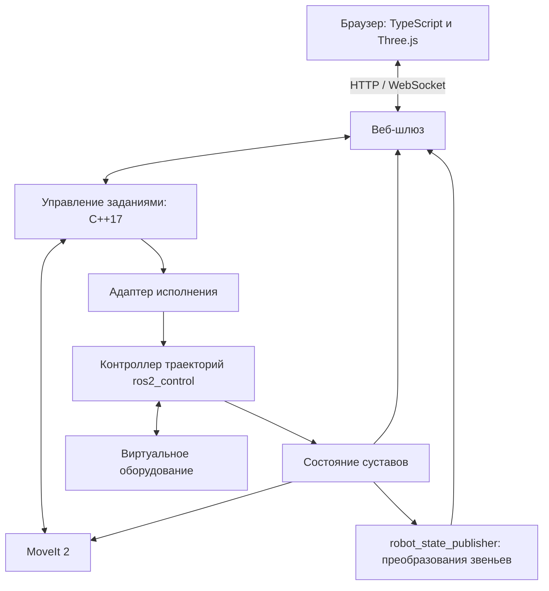

# План развития системы управления шестикоординатным манипулятором

Статус: проектирование. Этапы ниже описывают запланированные работы, а не уже реализованные возможности.

Обязательные уточнения: [архитектура и границы слоев](architecture.md), [многоуровневый API](api.md), [правила C++17](cpp17.md). Прикладное ядро независимо от ROS и оборудования; переносимость проверяется контрактными тестами адаптеров.

## 1. Цель и границы первой версии

Создать работающий демонстратор управления роботом с шестью вращательными суставами. Пользователь управляет им из браузера, сервер рассчитывает траектории, виртуальные приводы выполняют движение, а интерфейс показывает состояние выполнения.

Основной демонстрационный сценарий:

1. Открыть страницу с трехмерной моделью робота.
2. Задать шесть суставных координат или положение и ориентацию инструмента.
3. Рассчитать траекторию и увидеть ее предпросмотр.
4. Запустить выполнение и наблюдать движение по телеметрии.
5. Отменить задание или дождаться завершения и вернуться в исходную позу.

Первая версия не требует оборудования, физической симуляции контактов, компьютерного зрения или самостоятельной реализации алгоритмов кинематики. Предпросмотр и фактическое состояние виртуального робота должны визуально различаться.

## 2. Базовые технические решения

| Область | Предлагаемое решение |
| --- | --- |
| Окружение | Ubuntu 24.04, ROS 2 Jazzy |
| Прикладная логика управления | Независимые библиотеки Domain/Application на C++17; rclcpp в адаптерах |
| Кинематика и планирование | MoveIt 2, готовые решатели и планировщики |
| Выполнение траекторий | ros2_control, joint_trajectory_controller |
| Виртуальное оборудование | mock_components/GenericSystem |
| Начальная модель | UR5e из официального пакета ur_description |
| Описание конструкции | URDF/Xacro, геометрия отдельных звеньев, конфигурация MoveIt |
| Веб-интерфейс | TypeScript, Three.js; UI-фреймворк выбирается при реализации |
| Связь с браузером | HTTP для запросов и ресурсов, WebSocket для событий и телеметрии |
| Сборка серверной части | CMake, ament, colcon |

Перед установкой фиксируются совместимые версии пакетов для Jazzy. Зависимости не должны автоматически следовать веткам rolling/main. Выбор конкретной библиотеки веб-шлюза остается открытым до проверки совместимости и объема необходимого API.

Mock-оборудование отражает команды в состоянии суставов. Оно позволяет демонстрировать выполнение траекторий, но не подтверждает корректность динамики, нагрузок, трения или контактов.

## 3. Архитектура и ответственность

Система строится как набор взаимодействующих ROS-узлов с отдельным браузерным клиентом. Это реализует исходную идею разделения на сервисы; отдельный контейнер для каждого узла не является обязательным.



- **Узел управления заданиями:** проверяет запросы, управляет жизненным циклом задания, хранит связь между целью, планом и выполнением, обрабатывает отмену и ошибки.
- **MoveIt 2:** решает задачи кинематики, проверяет столкновения с учетом модели сцены и строит траектории с временными параметрами.
- **ros2_control:** выполняет траектории и предоставляет состояние через контроллеры и broadcaster; адаптер оборудования определяет способ исполнения команд.
- **Веб-шлюз:** переводит ограниченный прикладной API в ROS-взаимодействия, передает события и геометрию клиенту.
- **Браузер:** принимает пользовательский ввод, показывает состояние и планы. Суставы модели обновляются по серверной телеметрии.
- **Описание робота:** единый источник геометрии, осей, преобразований и ограничений для сервера и визуализации.

Внутри ROS используем topics для состояния, services для коротких операций и actions для длительных операций с обратной связью и отменой. Браузер не отправляет команды отдельных тактов приводов и не получает произвольный доступ ко всем ROS-интерфейсам.

## 4. Контракты и состояние системы

Контракты оформляются до подключения полноценного UI:

- Команды: получить описание и состояние, рассчитать план, выполнить конкретный план, отменить активное задание.
- Суставная цель: имена суставов и значения в радианах. Декартова цель: позиция в метрах, ориентация quaternion и явно указанная система координат.
- План: идентификатор, начальное состояние, цель, версия сцены и траектория. Перед выполнением проверяется актуальность начального состояния и сцены; устаревший план требует нового расчета.
- Телеметрия: суставные координаты, поза инструмента с системой координат, время, идентификатор задания, состояние исполнения и диагностические сообщения.
- Ошибки: недопустимые значения, выход за ограничения, недостижимая цель, отсутствие пути, устаревший план, недоступный контроллер, тайм-аут.
- Одновременно выполняется не более одного задания движения. Повторный запрос не должен незаметно запускать второе движение.

Планирование и исполнение являются отдельными операциями, план является неизменяемым ресурсом. Переходы состояний определены в [API](api.md). Готовность системы и соединение клиента учитываются отдельно. Подтверждение приема отмены не означает завершения движения: конечное состояние подтверждается исполнителем. При потере достоверного статуса используется `execution_unknown`, новые движения блокируются до сверки.

Первая версия рассчитана на одного оператора. При потере связи UI помечает данные как устаревшие и блокирует новые команды; сервер запрашивает отмену исполнения после настраиваемого тайм-аута управляющего сеанса. Повторное подключение получает актуальное состояние и не возобновляет движение автоматически.

## 5. Этапы реализации

### Этап 0. Воспроизводимое окружение и каркас

- Проверить установленное окружение ROS и совместимость зависимостей.
- Создать структуру пакетов, правила сборки и конфигурацию запуска.
- Добавить README с командами подготовки, сборки и запуска.
- Настроить игнорирование build/install/log, зависимостей frontend и локальных настроек.
- Создать независимые CMake targets Domain/Application и проверку направления зависимостей; зафиксировать clang-format, clang-tidy и CI для C++17.
- Оформить схемы API и контрактные примеры; реализовать fake-порты для проверки сценариев без ROS.

**Критерий готовности:** новый checkout можно подготовить и собрать по документации; сборка проверяется автоматически.

### Этап 1. Модель и суставное состояние

- Подключить описание UR5e и сохранить сведения об источнике и лицензии ресурсов.
- Настроить шесть суставов, пределы, базовую систему координат и систему инструмента.
- Подключить robot_state_publisher и проверить модель в RViz как инструменте разработчика.
- Настроить ros2_control с виртуальным оборудованием, broadcaster состояния и контроллером траекторий.

**Критерий готовности:** тестовая суставная траектория выполняется через контроллер; состояние и преобразования звеньев согласованы с моделью.

### Этап 2. Планирование и управление заданиями

- Создать конфигурацию MoveIt: группа манипулятора, решатель кинематики, планировщик, ограничения скорости и ускорения.
- Реализовать сценарии C++17 для суставных и декартовых целей в Application, подключить их к ROS через отдельный сервер и адаптеры.
- Разделить расчет, предпросмотр и выполнение плана; добавить отмену и обработку ошибок.
- Включить проверку самостолкновений и простую сцену с основанием или столом.

**Критерий готовности:** через ROS API выполняются переходы между несколькими целями; ошибочные цели возвращают объяснимую ошибку, отмена завершает активное задание, устаревший план не исполняется.

### Этап 3. Веб-шлюз и интерактивная модель

- Реализовать и документировать HTTP/WebSocket API.
- Предоставлять браузеру описание робота и локально обслуживаемые геометрические ресурсы.
- Отображать модель через Three.js с готовым загрузчиком URDF и геометрии.
- Добавить управление камерой, ввод шести суставных координат, телеметрию и статус подключения.
- Проверить соответствие позы в браузере состоянию ROS на нескольких конфигурациях.

**Критерий готовности:** браузер показывает реальное состояние виртуального робота, корректно переживает переподключение; все ресурсы загружаются без внешних CDN во время демонстрации.

### Этап 4. Законченный демонстратор

- Добавить ввод позиции и ориентации инструмента с отображением выбранной системы координат.
- Добавить предпросмотр рассчитанного движения, выполнение и отмену.
- Добавить именованные позы, возврат в исходную позу через планирование и журнал заданий текущего сеанса.
- Отобразить недостижимую цель, ошибку планирования и недоступность серверных компонентов.
- Подготовить короткий воспроизводимый сценарий демонстрации.

**Критерий готовности:** весь сценарий из раздела 1 выполняется из браузера; интерфейс не зависает при ошибках или разрыве соединения. Это граница первой законченной версии.

### Этап 5. Повторяемые сценарии и устойчивость

- Добавить сохранение последовательностей поз и их последовательное выполнение.
- Ввести версионируемый формат сценария с проверкой модели робота и параметров.
- Добавить препятствия в сцену и демонстрацию перепланирования.
- Расширить диагностику: длительность планирования, причины отказов, состояние компонентов.
- Подготовить воспроизводимую упаковку запуска; Docker Compose использовать при необходимости изоляции окружения.

**Критерий готовности:** сохраненный сценарий воспроизводится после перезапуска, ошибка отдельного шага останавливает последовательность с понятным результатом.

### Этап 6. Физическая симуляция (необязательно)

- Подключить Gazebo и совместимую интеграцию ros2_control.
- Проверить массы, инерции, collision-геометрию и настройки контроллеров.
- Добавить сценарии контактов и работы с объектами, если это требуется демонстрации.

**Критерий готовности:** тот же прикладной API управляет физической симуляцией; ее ограничения и отличия от mock-режима задокументированы.

### Этап 7. Реальное оборудование (отдельный объем работ)

- Выбрать приводы, контроллер, протокол и требования к частоте управления.
- Реализовать или подключить аппаратный интерфейс ros2_control.
- Выполнить калибровку, определить процедуры включения и восстановления после ошибок.
- Реализовать аппаратный аварийный останов и ограничения, независимые от браузера.
- Проверить поведение при потере связи и отказах на стенде, затем проводить испытания с ограниченными скоростями.

**Критерий готовности:** отдельная программа стендовых испытаний пройдена. Работа демонстратора сама по себе не подтверждает готовность к эксплуатации на оборудовании.

## 6. Предлагаемая структура репозитория

```text
docs/                         Архитектура, API, сценарии и план развития
core/domain/                  Независимые типы и инварианты C++17
core/application/             Независимые сценарии и порты C++17
api/                          OpenAPI и схемы событий при реализации
ros2_ws/src/
  manipulator_description/    Подключение и настройка модели робота
  manipulator_moveit_config/  Конфигурация планирования
  manipulator_interfaces/     Прикладные ROS-контракты при необходимости
  manipulator_adapters/       Планирование, исполнение и источники состояния
  manipulator_server/         ROS ingress и создание зависимостей
  manipulator_hardware/       При появлении собственного оборудования
  manipulator_web_gateway/    HTTP/WebSocket-шлюз
  manipulator_bringup/        Launch-файлы и параметры режимов запуска
frontend/                     Браузерный интерфейс
tests/                        Сквозные сценарии; модульные тесты рядом с пакетами
```

Пакеты создаются по мере появления функций. Внешние модели и библиотеки подключаются с фиксированными версиями и сохранением лицензий.

## 7. Проверка качества

- Модульные проверки прикладной логики: валидация целей, переходы состояний, повторные запросы, отмена и актуальность плана.
- Интеграционные проверки на mock-оборудовании: планирование, выполнение, конечная поза в заданном допуске и отказ контроллера.
- Отрицательные сценарии: нечисловые значения, неверные суставы или системы координат, выход за пределы, отсутствие пути, разрыв соединения.
- Браузерные проверки: загрузка геометрии, ненулевое изображение сцены, соответствие движения телеметрии, отсутствие перекрытий UI на настольном и мобильном экране.
- Сквозная проверка: цель из браузера проходит планирование и выполнение; результат задания и конечная поза отображаются корректно.

Допуски конечной позы, тайм-ауты и параметры скорости фиксируются в конфигурации и учитываются в тестах. Проверки ориентированы на собственные контракты и интеграцию, а не на повторное тестирование внутренностей ROS или MoveIt.

## 8. Основные риски и решения

| Риск | Решение |
| --- | --- |
| Единый STL не содержит суставов | Использовать готовый URDF/Xacro с геометрией звеньев |
| Несовпадение серверной модели и изображения | Единое описание, явные системы координат и единицы, проверка нескольких поз |
| Устаревшая траектория | Проверять начальное состояние и сцену перед исполнением |
| Недостижимые цели и особенности кинематики | Использовать готовый решатель, возвращать причины отказа, проверять ограничения |
| Различия версий ROS-пакетов | Зафиксировать Jazzy и совместимые зависимости, проверять чистую сборку |
| Демонстрация зависит от интернета | Обслуживать геометрию и frontend локально |
| Чрезмерное дробление компонентов | Разделять по ответственности; не выносить каждый алгоритм в отдельный процесс |

## 9. Справочные материалы

- [Требования платформ ROS 2, REP-2000](https://github.com/ros-infrastructure/rep/blob/master/rep-2000.rst)
- [Начало работы с MoveIt 2](https://moveit.picknik.ai/main/doc/tutorials/getting_started/getting_started.html)
- [C++-интерфейс MoveIt](https://moveit.picknik.ai/main/doc/examples/move_group_interface/move_group_interface_tutorial.html)
- [Mock-компоненты ros2_control для Jazzy](https://control.ros.org/jazzy/doc/ros2_control/hardware_interface/doc/mock_components_userdoc.html)
- [Официальное описание Universal Robots](https://github.com/UniversalRobots/Universal_Robots_ROS2_Description)

Ссылки MoveIt на main служат справочными: при реализации необходимо сверяться с API выбранной версии Jazzy.
